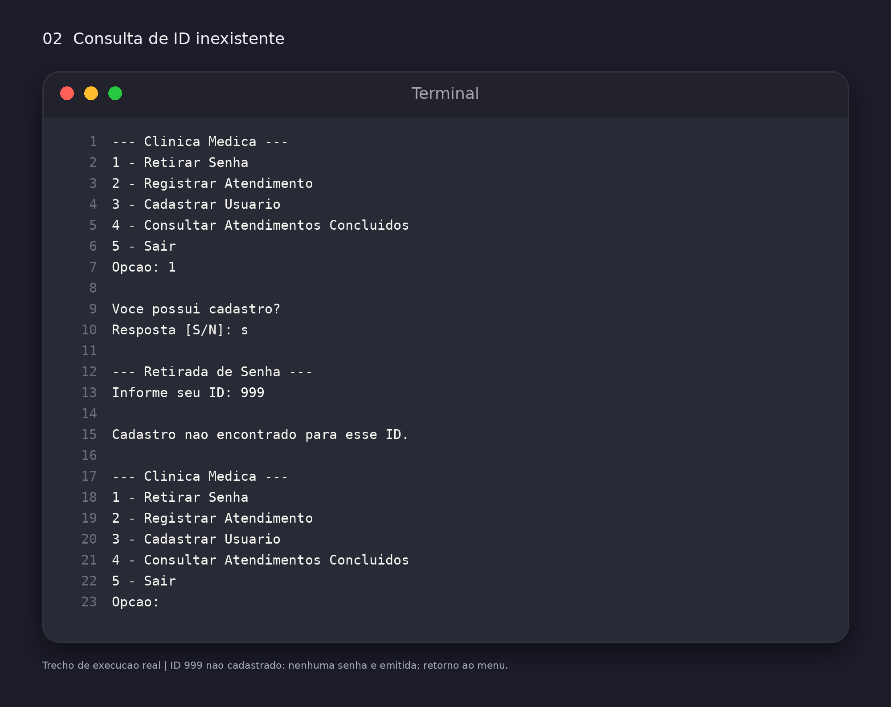
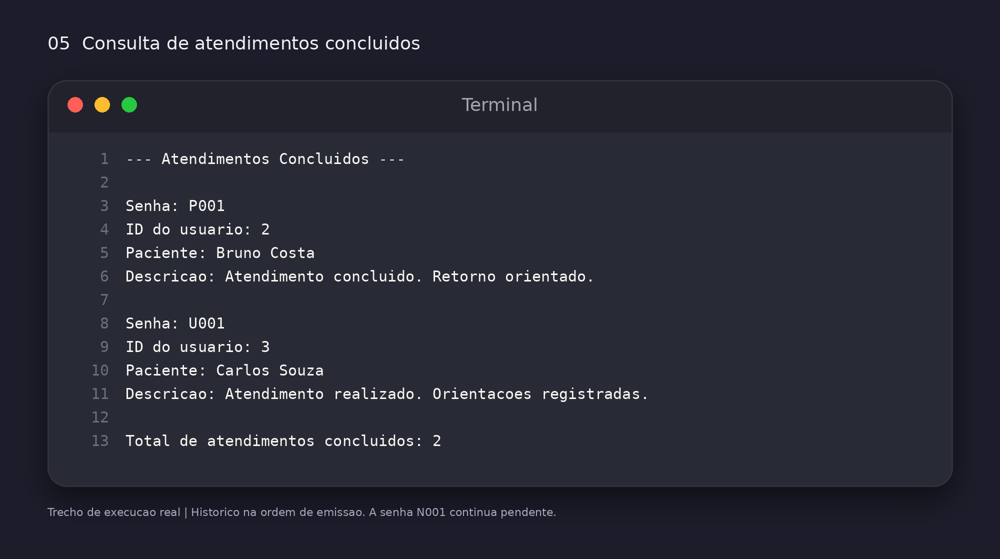

# 🏥 Gerenciamento de Senhas de Atendimento — C

> Projeto desenvolvido em **linguagem C** para a disciplina de **Desenvolvimento de Algoritmo e Pensamento Computacional**, com foco em funções, estruturas de dados, vetores e organização de uma fila por prioridade.

---

## 📌 Sobre o projeto

O **Sistema de Gerenciamento de Senhas de Atendimento** simula o atendimento em uma clínica de especialidades médicas pelo terminal.

O programa permite cadastrar usuários, emitir senhas conforme a prioridade, atender os pacientes e consultar as descrições dos atendimentos concluídos. Cada senha está vinculada ao ID de um usuário, permitindo recuperar seus dados durante o atendimento.

**Os cadastros, as senhas e as descrições ficam na memória durante a execução.** Ao encerrar o programa, os dados são perdidos. Esta versão não utiliza arquivos nem banco de dados para persistência.

---

## ⚙️ Funcionalidades e menu

| Opção | Funcionalidade | Descrição |
| :---: | --- | --- |
| **1** | 🎟️ Retirar senha | Consulta o usuário pelo ID e emite uma senha. Também permite cadastrar uma pessoa antes da retirada. |
| **2** | 🩺 Registrar atendimento | Exibe o resumo e a fila, seleciona a próxima senha e recebe a descrição do atendimento. |
| **3** | 📝 Cadastrar usuário | Realiza um cadastro e informa seu ID, sem emitir senha automaticamente. |
| **4** | 📋 Consultar atendimentos concluídos | Exibe a senha, o ID, o nome do paciente, a descrição e o total de atendimentos concluídos. |
| **5** | 🚪 Sair | Encerra o programa. |

---

## 📝 Cadastro de usuários

Cada cadastro recebe um **ID sequencial**, começando em `1`, e reúne os seguintes dados:

| Campo | Informação |
| --- | --- |
| Nome | Nome do usuário, incluindo espaços. |
| Idade | Número inteiro positivo, com validação básica. |
| Gênero | `M` — Masculino, `F` — Feminino ou `O` — Outro. |
| Gestante | Resposta de sim ou não; a pergunta é feita apenas quando o gênero informado é feminino. |
| Necessidade especial | Resposta de sim ou não, solicitada a todos os usuários. |

As opções de gênero e as respostas de sim ou não aceitam letras maiúsculas e minúsculas. As respostas reconhecidas são `s`, `sim`, `n` e `nao`, sem acento.

Na opção **1**, quando a pessoa ainda não possui cadastro, o questionário é apresentado primeiro. Após concluir o cadastro, é necessário informar o ID recém-gerado para retirar a senha.

---

## 🚦 Classificação de prioridade

O projeto utiliza as seguintes regras de classificação:

| Código | Categoria | Critério | Exemplo |
| :---: | --- | --- | :---: |
| **U** | Urgente | Usuários com **mais de 80 anos**. | `U001` |
| **P** | Preferencial | Gestantes ou pessoas com necessidade especial que não se enquadram em `U`. | `P001` |
| **N** | Normal | Demais usuários. | `N001` |

A idade é verificada primeiro. Assim, uma pessoa com 81 anos e necessidade especial recebe uma senha `U`.

**A condição usada é `idade > 80`.** Uma pessoa com exatamente 80 anos, sem outra condição de preferência, recebe uma senha `N`.

Cada categoria possui um contador independente. Por isso, `N001`, `P001` e `U001` podem existir na mesma execução. A letra junto ao número identifica a senha; o número sozinho não é suficiente.

---

## 🔁 Fila e registro de atendimento

Ao selecionar a opção **2**, o programa:

1. Mostra o total de senhas emitidas e a quantidade de pessoas aguardando em cada categoria.
2. Exibe as senhas pendentes na ordem **Urgente → Preferencial → Normal**.
3. Seleciona automaticamente a primeira senha da fila.
4. Busca o cadastro pelo ID vinculado à senha e apresenta os dados do paciente.
5. Recebe uma descrição textual do atendimento.
6. Marca a senha como atendida e pergunta se deseja continuar.

Dentro de cada categoria, a ordem de emissão é preservada. Se a resposta for `s`, a fila é exibida novamente, já sem a senha atendida. Se for `n`, o programa retorna ao menu. Quando não há senhas pendentes, exibe uma mensagem e volta ao menu.

O texto da descrição não passa por análise de conteúdo, mas é necessário digitar algum texto para concluir a leitura.

**Os totais de senhas emitidas não diminuem após um atendimento.** As quantidades pendentes são recalculadas a partir das senhas que ainda não foram atendidas.

---

## 📋 Consulta de atendimentos concluídos

A opção **4** percorre o vetor de senhas e apresenta somente os registros com o campo `atendida` igual a `'s'`.

Para cada atendimento, são exibidos:

* Código da senha;
* ID do usuário;
* Nome do paciente;
* Descrição registrada.

Ao final, é mostrado o total de atendimentos concluídos. Caso não exista nenhum, o programa informa essa situação.

A consulta mantém a **ordem de emissão das senhas**, conforme estão armazenadas no vetor, e não a ordem em que os atendimentos foram realizados. Consultar o histórico não altera os registros nem a fila.

---

## 💾 Estruturas e armazenamento

O código utiliza dois tipos definidos com `typedef struct`:

| Estrutura | Campos | Vetor de armazenamento |
| --- | --- | --- |
| `Usuario` | `id`, `nome`, `idade`, `genero`, `gestante` e `necessidadeEspecial` | `usuarios[MAX_CADASTROS]` |
| `Senha` | `idUsuario`, `prioridade`, `numero`, `atendida` e `descricao` | `senhas[MAX_SENHAS]` |

O campo `idUsuario` faz a ligação entre a senha e o cadastro. O campo `atendida` começa como `'n'` e passa para `'s'` quando o atendimento é finalizado.

Os limites definidos são **100 cadastros** e **100 senhas no total**, contando todas as categorias. As senhas concluídas permanecem armazenadas para consulta e continuam ocupando espaço no vetor.

---

## 🧠 Conceitos de programação utilizados

* 🔤 Variáveis dos tipos `int` e `char`, strings e vetores;
* 🧱 Agrupamento de dados com `struct` e definição de tipos com `typedef`;
* 🧩 Funções com parâmetros e valores de retorno;
* ⌨️ Entrada de dados com `scanf()` e `getchar()`;
* 🖥️ Saída de dados com `printf()`;
* 🔀 Condições com `if`, `else` e `switch`;
* 🔁 Repetições com `for` e `while`, incluindo laços aninhados;
* 🔍 Busca sequencial por ID;
* 🔠 Comparação de textos com `strcmp()` e conversão para minúsculas com `tolower()`;
* 📊 Contadores por categoria e filtragem de registros por situação.

### Bibliotecas utilizadas

| Biblioteca | Uso no programa |
| --- | --- |
| `stdio.h` | Entrada e saída de dados: `printf`, `scanf`, `getchar` e `EOF`. |
| `ctype.h` | Conversão de caracteres para minúsculas com `tolower`. |
| `string.h` | Comparação de strings com `strcmp`. |

---

## 🧩 Organização do código

Toda a implementação está no arquivo [`main.c`](./main.c), dividida nas seguintes funções:

| Função | Responsabilidade |
| --- | --- |
| `limparEntrada()` | Descarta o restante da linha digitada. |
| `converterMinusculo()` | Converte as letras das opções para minúsculas. |
| `lerInteiroPositivo()` | Faz a leitura básica de um número maior que zero. |
| `perguntar()` | Recebe e valida as respostas de sim ou não. |
| `cadastro()` | Coleta os dados, gera o ID e armazena o usuário. |
| `buscarUsuario()` | Procura um ID e retorna a posição do cadastro ou `-1`. |
| `classificarPrioridade()` | Define a categoria `U`, `P` ou `N`. |
| `gerarSenha()` | Numera, armazena e exibe a senha. |
| `mostrarFila()` | Conta os pendentes, exibe a fila e retorna a posição da próxima senha. |
| `registrarAtendimento()` | Registra a descrição e finaliza o atendimento. |
| `consultarAtendimentos()` | Exibe as senhas concluídas e suas descrições. |
| `main()` | Apresenta o menu e chama as funções correspondentes. |

---

## ▶️ Como executar

É necessário ter um compilador C, como **GCC**, instalado e disponível no terminal. O código utiliza recursos de C99 ou posterior; os comandos abaixo selecionam **C11**.

Abra o terminal na pasta `gerenciamento_senhas/`.

### Windows — PowerShell

Compile e execute:

```powershell
gcc -std=c11 -Wall -Wextra -Wpedantic main.c -o gerenciamento_senhas.exe
.\gerenciamento_senhas.exe
```

### Linux/macOS

Compile e execute:

```bash
gcc -std=c11 -Wall -Wextra -Wpedantic main.c -o gerenciamento_senhas
./gerenciamento_senhas
```

Não há dependências externas além das bibliotecas padrão da linguagem C utilizadas pelo programa.

---

## 🧪 Testes e demonstrações

As imagens abaixo apresentam **trechos de uma execução real do programa**, com dados fictícios e formatação visual de terminal para documentação.

Os cenários foram realizados na mesma execução: Lucas Almeida, de 25 anos, recebeu o ID `1`; Bruno Costa, de 40 anos e com necessidade especial, recebeu o ID `2`; Carlos Souza, de 81 anos, recebeu o ID `3`. Após testar o ID inexistente, foram emitidas as senhas `N001`, `P001` e `U001`, respectivamente.

### 1. Cadastro de usuário

**Resultado verificado:** registro dos dados e geração do ID `1` para Lucas Almeida.


### 2. Consulta de ID inexistente

**Entrada:** ID `999`, sem cadastro correspondente.  
**Resultado verificado:** mensagem de cadastro não encontrado e retorno ao menu, sem emitir senha.



### 3. Fila ordenada por prioridade

**Situação:** uma senha pendente de cada categoria.  
**Resultado verificado:** resumo com três pessoas aguardando e fila na ordem `U001`, `P001`, `N001`.


### 4. Registro de atendimento

**Situação:** atendimento da senha `U001`, vinculada a Carlos Souza.  
**Resultado verificado:** dados do paciente apresentados, descrição registrada e senha marcada como atendida. A resposta `n` retorna ao menu.


### 5. Consulta de atendimentos concluídos

**Situação:** as senhas `U001` e `P001` já foram atendidas; `N001` permanece pendente.  
**Resultado verificado:** exibição de dois atendimentos, com nomes e descrições correspondentes. `P001` aparece antes de `U001` porque a consulta segue a ordem de emissão.



---

## ⚠️ Limitações da versão atual

* **Sem persistência:** os dados são perdidos ao encerrar o programa e os contadores recomeçam na próxima execução.
* **Capacidade fixa:** o limite de 100 senhas inclui as atendidas; finalizar um atendimento não libera uma posição.
* **Validação numérica básica:** entradas como `25abc` e `25.5` podem ser interpretadas como `25`. Valores fora da capacidade de `int` não são tratados de forma confiável.
* **Textos limitados:** o nome comporta até 99 bytes de texto e a descrição até 499, além do terminador. O excedente é descartado sem aviso; letras acentuadas podem ocupar mais de um byte.
* **Senhas repetidas por usuário:** uma mesma pessoa pode retirar várias senhas enquanto ainda aguarda atendimento.
* **Descrição obrigatória:** uma linha vazia faz a leitura continuar esperando texto, sem mensagem adicional.
* **Prioridade fixa:** o próximo atendimento é escolhido automaticamente; não há seleção manual de outra senha nem alternância entre categorias.

---

## 📁 Arquivos do projeto

| Caminho | Conteúdo |
| --- | --- |
| [`main.c`](./main.c) | Código-fonte do programa. |
| [`README.md`](./README.md) | Documentação do projeto. |
| [`imagens/`](./imagens/) | Cinco imagens dos testes realizados no terminal. |

---

## 🎯 Objetivo acadêmico

Aplicar os fundamentos de programação em C na construção de um sistema que relaciona cadastros, senhas e atendimentos. O projeto exercita a organização de dados com estruturas, o uso de vetores, a divisão de responsabilidades em funções e o controle de uma fila por prioridade.

## 📚 Disciplina

**Desenvolvimento de Algoritmo e Pensamento Computacional**  
**Curso:** Análise e Desenvolvimento de Sistemas  
**Ano:** 2026

---

⭐ *Projeto desenvolvido para fins acadêmicos e de aprendizado da linguagem C.*
