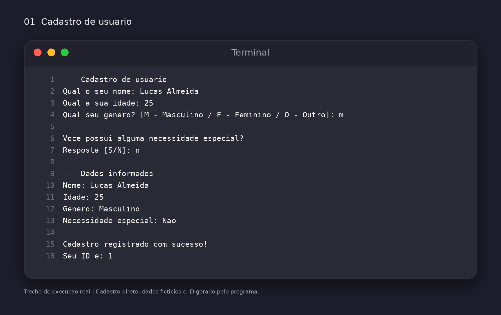
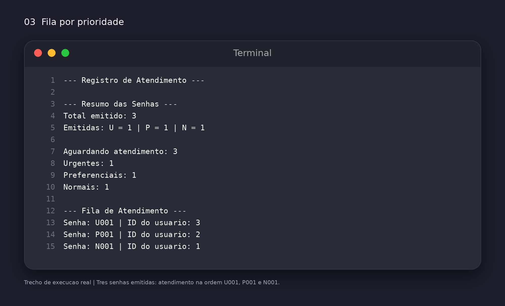
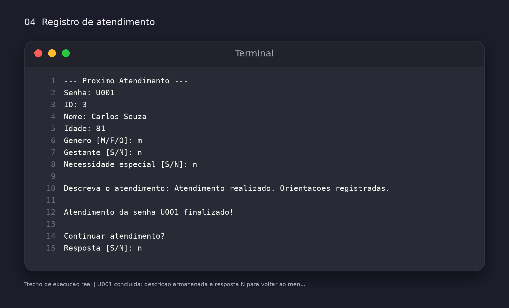

# 🏥 Gerenciamento de Senhas de Atendimento — C

> Projeto desenvolvido em **linguagem C** para a disciplina de **Desenvolvimento de Algoritmo e Pensamento Computacional**, com foco em funções, estruturas de dados, vetores, modularização e organização de uma fila por prioridade.

---

## 📌 Sobre o projeto

O **Sistema de Gerenciamento de Senhas de Atendimento** simula o atendimento em uma clínica de especialidades médicas pelo terminal.

O programa permite cadastrar usuários, emitir senhas conforme a prioridade, chamar pacientes, finalizar atendimentos e consultar o histórico. Cada senha está vinculada ao ID de um usuário, permitindo recuperar seus dados durante o atendimento.

**Cadastro e retirada de senha são operações separadas.** Quem já possui cadastro informa seu ID para retirar uma senha, sem cadastrar a pessoa novamente. As operações de atendimento ficam reunidas em um submenu.

**Os dados ficam na memória durante a execução.** Ao encerrar o programa, cadastros, senhas e descrições são perdidos. Esta versão não utiliza arquivos nem banco de dados para persistência.

---

## ⚙️ Funcionalidades e menus

### Menu principal

| Opção | Funcionalidade | Descrição |
| :---: | --- | --- |
| **1** | 📝 Cadastrar usuário | Coleta os dados e informa o ID, sem emitir senha automaticamente. |
| **2** | 🎟️ Retirar senha | Solicita o ID de um usuário já cadastrado e emite a senha conforme sua prioridade. |
| **3** | 🩺 Atendimento | Abre o submenu de consultas, chamada, finalização e histórico. |
| **4** | 🖥️ Mostrar painel de chamada | Exibe a senha atual, a fila ordenada e os contadores. |
| **0** | 🚪 Sair | Encerra o programa. |

### Submenu de atendimento

| Opção | Funcionalidade | Descrição |
| :---: | --- | --- |
| **1** | Consultar próxima senha | Mostra a primeira senha aguardando, sem alterar a fila. |
| **2** | Chamar próximo paciente | Seleciona a próxima senha e inicia o atendimento. |
| **3** | Consultar senha em atendimento | Apresenta a senha atual e os dados do paciente chamado. |
| **4** | Finalizar atendimento | Recebe a descrição, conclui o atendimento e informa a próxima senha aguardando. |
| **5** | Consultar atendimentos concluídos | Exibe os registros finalizados, suas descrições e o total de atendimentos concluídos. |
| **0** | Voltar ao menu principal | Fecha o submenu. |

O submenu permanece aberto após cada operação. Para cadastrar outro usuário, retirar uma senha ou consultar o painel, escolha **0** para voltar ao menu principal.

---

## 📝 Cadastro de usuários

Cada cadastro recebe um **ID sequencial**, começando em `1`, e reúne os seguintes dados:

| Campo | Informação |
| --- | --- |
| Nome | Nome do usuário, incluindo espaços. |
| Idade | Número inteiro maior ou igual a zero. O valor `0` representa menos de um ano de idade. |
| Gênero | `M` — Masculino, `F` — Feminino ou `O` — Outro. |
| Gestante | Pergunta apresentada para os gêneros `F` e `O`; responda `N` quando não se aplicar. Para `M`, o valor é definido como `n`. |
| Lactante | Resposta de sim ou não, solicitada a todos os usuários. |
| Necessidade especial | Resposta de sim ou não, solicitada a todos os usuários. |
| Obesidade | Resposta de sim ou não, solicitada a todos os usuários. |

As opções de gênero e as respostas de sim ou não aceitam letras maiúsculas e minúsculas. As respostas reconhecidas são `s`, `sim`, `n` e `nao`, sem acento.

Campos vazios, textos que ultrapassam o limite do campo e números fora do intervalo aceito são solicitados novamente. Se a entrada terminar antes da conclusão do questionário, o cadastro incompleto não é gravado.

**Para quem já possui cadastro, use o ID na opção 2.** A opção 1 cria um novo registro e não verifica duplicidade de pessoas pelo nome.

---

## 🎟️ Retirada de senha

Na opção **2** do menu principal, o programa busca o cadastro pelo ID e utiliza seus dados para classificar e emitir a senha.

* Um ID inexistente não gera senha nem cadastro.
* A retirada não altera os dados do usuário nem aumenta o total de cadastros.
* Um usuário não pode ter duas senhas ativas: uma nova retirada é bloqueada enquanto houver uma senha sua aguardando ou em atendimento.
* Após finalizar o atendimento, o mesmo ID pode ser usado para retirar outra senha, respeitando o limite de senhas da execução.

**Exemplo:** cadastre Lucas na opção 1 e anote o ID `1`. Na opção 2, informe esse ID para emitir sua senha. Em uma nova retirada após a finalização, informe novamente o ID `1`, sem repetir o cadastro.

---

## 🚦 Classificação de prioridade

A classificação segue as regras didáticas adotadas no projeto:

| Código | Categoria | Critério | Exemplo |
| :---: | --- | --- | :---: |
| **U** | Urgente | Idade **superior a 80 anos**, independentemente do gênero ou de outras condições. | `U001` |
| **P** | Preferencial | Sem se enquadrar em `U`: gestante, lactante, pessoa com necessidade especial, pessoa com obesidade, mulher com **60 anos ou mais** ou homem com **65 anos ou mais**. | `P001` |
| **N** | Normal | Nenhuma das condições anteriores. | `N001` |

A urgência é verificada primeiro. Uma pessoa com 81 anos recebe uma senha `U`, mesmo que também se enquadre em alguma condição de preferência.

**Exatamente 80 anos não gera urgência.** Nessa idade, usuários dos gêneros `M` e `F` recebem `P` pelos critérios etários. Para o gênero `O`, o código não define uma faixa etária preferencial: aplicam-se as condições informadas e a urgência acima de 80 anos.

Cada categoria possui um contador independente. Por isso, `N001`, `P001` e `U001` podem existir na mesma execução. A letra junto ao número identifica a senha; o número sozinho não é suficiente.

> As categorias são regras da atividade acadêmica e não substituem uma avaliação clínica de risco.

---

## 🔁 Fila e fluxo de atendimento

A chamada segue a ordem **Urgente → Preferencial → Normal**. Dentro de cada categoria, é preservada a ordem de emissão: a primeira senha emitida é a primeira chamada, seguindo o princípio FIFO.

| Estado | Significado | Como muda |
| --- | --- | --- |
| `AGUARDANDO` | A senha foi emitida e está na fila. | A opção **2** do submenu chama o paciente. |
| `EM_ATENDIMENTO` | O paciente já foi chamado. | A opção **4** do submenu registra a descrição e finaliza. |
| `FINALIZADA` | O atendimento foi concluído e está disponível no histórico. | A senha permanece finalizada e não volta à fila. |

Somente **um atendimento pode estar ativo por vez**. Antes de chamar outra pessoa, é necessário finalizar o atendimento atual. A chegada de uma senha urgente não interrompe um atendimento em andamento.

Consultar a próxima senha não a retira da fila. Finalizar um atendimento exige uma descrição não vazia; o texto é armazenado sem análise de conteúdo. Após a finalização, o programa informa a próxima senha, mas sua chamada depende da opção **2** do submenu.

Os totais de senhas emitidas não diminuem após um atendimento. A fila e as quantidades em espera são calculadas considerando apenas as senhas no estado `AGUARDANDO`.

---

## 🖥️ Painel de chamada

A opção **4** do menu principal apresenta:

* A senha atualmente chamada e sua categoria, quando houver atendimento ativo;
* As próximas senhas na ordem de chamada;
* As quantidades em espera por categoria e o total da fila;
* Os totais de senhas emitidas, por categoria e no conjunto da execução.

O painel apenas consulta os dados. Senhas em atendimento ou finalizadas não entram na contagem de pessoas em espera.

---

## 📋 Consulta de atendimentos concluídos

A opção **5 do submenu de atendimento** apresenta somente as senhas no estado `FINALIZADA`.

Para cada atendimento, são exibidos o código da senha, a categoria, o nome do paciente, o ID, a idade e a descrição registrada. Ao final, é mostrado o total de atendimentos concluídos; quando não há registros, esse total é zero.

A consulta mantém a **ordem de emissão das senhas**, conforme estão armazenadas no vetor, e não a ordem de realização dos atendimentos. Consultar o histórico não altera os registros nem a fila.

---

## 💾 Estruturas e armazenamento

| Tipo | Responsabilidade e campos |
| --- | --- |
| `Usuario` | Cadastro com `id`, `nome`, `idade`, `genero`, `gestante`, `lactante`, `necessidadeEspecial` e `obesidade`. |
| `EstadoSenha` | Enumeração dos estados `AGUARDANDO`, `EM_ATENDIMENTO` e `FINALIZADA`. |
| `Senha` | Registro com `idUsuario`, `prioridade`, `numero`, `estado` e `descricao`. |
| `Sistema` | Reúne os vetores `usuarios[MAX_CADASTROS]` e `senhas[MAX_SENHAS]`, os totais de cadastros e senhas e os contadores por categoria. |

O campo `idUsuario` faz a ligação entre a senha e o cadastro. O `main()` inicializa uma variável `Sistema` com zeros e passa seu endereço às funções. Não há variáveis globais para armazenar os dados do sistema.

Os limites são **100 cadastros** e **100 senhas por execução**, contando todas as categorias. São limites independentes: ter 100 usuários cadastrados não impede a emissão para um deles enquanto houver espaço no vetor de senhas.

As senhas finalizadas permanecem armazenadas para consulta e continuam ocupando espaço. Encerrar o programa apaga os dados, e os IDs e contadores reiniciam na próxima execução.

---

## 🧩 Organização do código

A implementação está dividida em **um arquivo `.c` e quatro arquivos `.h`**:

| Arquivo | Responsabilidade |
| --- | --- |
| [`main.c`](./main.c) | Inicialização do sistema e menu principal com `switch/case`. |
| [`registro.h`](./registro.h) | Estruturas de senha e sistema, leitura e validação de entradas, cadastro, busca por ID e emissão de senhas. |
| [`classificacao.h`](./classificacao.h) | Estrutura `Usuario`, classificação de prioridade e nomes das categorias. |
| [`atendimento.h`](./atendimento.h) | Submenu de atendimento, consultas, chamada, finalização e histórico. |
| [`painel.h`](./painel.h) | Exibição da senha atual, fila ordenada e contadores. |

### Principais funções

| Função | Responsabilidade |
| --- | --- |
| `lerTexto()` | Lê uma linha, remove espaços das pontas e rejeita entradas vazias ou longas demais. |
| `lerInteiro()` | Converte o texto e valida um número inteiro dentro do intervalo solicitado. |
| `converterMinusculo()` e `perguntar()` | Normalizam as opções e validam respostas de sim ou não. |
| `cadastrarUsuario()` | Coleta os dados, gera o ID e armazena somente o cadastro. |
| `buscarUsuario()` | Procura um ID e retorna sua posição no vetor ou `-1`. |
| `classificarPrioridade()` e `nomeCategoria()` | Definem a categoria e seu nome para exibição. |
| `gerarSenha()` | Cria a senha para um ID existente, respeitando o limite e o bloqueio de senhas simultâneas. |
| `registrarSenha()` | Solicita o ID, trata os resultados da emissão e apresenta a senha gerada. |
| `buscarProximaSenha()` e `buscarEmAtendimento()` | Localizam a próxima senha aguardando e a senha em atendimento. |
| `exibirDadosSenha()` | Exibe a senha e os dados do paciente associado. |
| `consultarProximaSenha()` e `consultarEmAtendimento()` | Consultam as senhas sem modificar seu estado. |
| `chamarPaciente()` | Inicia o atendimento da próxima senha, se não houver outro ativo. |
| `finalizarAtendimento()` | Registra a descrição e muda o estado da senha para `FINALIZADA`. |
| `consultarAtendimentos()` | Exibe os registros finalizados e suas descrições. |
| `menuAtendimento()` | Reúne as operações no submenu. |
| `mostrarPainel()` | Exibe a senha atual, a fila e os totais. |
| `main()` | Apresenta o menu principal e chama os módulos. |

Para manter o formato da atividade, as funções estão implementadas nos próprios cabeçalhos, protegidos por `#ifndef` e `#define`. **Compile apenas `main.c`, mantendo os quatro `.h` na mesma pasta.** Se o projeto passar a ter vários arquivos `.c`, as implementações deverão ser movidas para arquivos `.c` próprios, deixando as declarações nos cabeçalhos.

---

## 🧠 Conceitos de programação utilizados

* 🔤 Variáveis, strings e vetores;
* 🧱 Estruturas `struct`, definição de tipos com `typedef` e estados com `enum`;
* 🧩 Funções, parâmetros, retornos e organização em módulos;
* 📍 Ponteiros para compartilhar e modificar os dados do sistema;
* ⌨️ Entrada com `fgets()`, conversão com `strtol()` e validação de intervalos;
* 🖥️ Saída com `printf()` e `puts()`;
* 🔀 Condições com `if`, `else` e `switch/case`;
* 🔁 Repetições com `for` e `while`, incluindo laços aninhados;
* 🔍 Busca sequencial por ID e filtragem de registros por estado;
* 🚦 Prioridade entre categorias e FIFO dentro de cada categoria;
* 📊 Contadores independentes e consulta sem alteração dos dados.

### Bibliotecas utilizadas

| Biblioteca | Uso no programa |
| --- | --- |
| `stdio.h` | Entrada e saída com `fgets`, `getchar`, `printf`, `puts`, `fflush` e tratamento de `EOF`. |
| `stdlib.h` | Conversão de texto para inteiro com `strtol`. |
| `string.h` | Comparação, busca, tamanho e movimentação de strings com `strcmp`, `strchr`, `strlen` e `memmove`. |
| `ctype.h` | Conversão para minúsculas com `tolower` e identificação de espaços com `isspace`. |
| `errno.h` | Verificação de erro de conversão numérica com `errno` e `ERANGE`. |
| `limits.h` | Limite de valores inteiros com `INT_MAX`. |

---

## ▶️ Como executar

É necessário ter um compilador C, como **GCC**, instalado e disponível no terminal. Os comandos abaixo selecionam **C11**.

Abra o terminal na pasta que contém `main.c`, `registro.h`, `classificacao.h`, `atendimento.h` e `painel.h`. No repositório geral da disciplina, essa pasta é `gerenciamento_senhas/`.

### Windows — PowerShell

```powershell
gcc -std=c11 -Wall -Wextra -Wpedantic main.c -o gerenciamento_senhas.exe
.\gerenciamento_senhas.exe
```

### Linux/macOS

```bash
gcc -std=c11 -Wall -Wextra -Wpedantic main.c -o gerenciamento_senhas
./gerenciamento_senhas
```

Os arquivos `.h` são incluídos por `main.c` e não devem ser compilados separadamente. Em uma IDE, configure o projeto como C e use `main.c` como arquivo de compilação.

Não há dependências externas além das bibliotecas padrão da linguagem C utilizadas pelo programa.

---

## 🧪 Testes e demonstrações

As imagens apresentam **trechos de uma execução real da versão atual**, com dados fictícios e formatação visual de terminal para documentação.

Os cinco cenários foram realizados na mesma execução:

| Usuário fictício | Idade | ID | Categoria e senha |
| --- | :---: | :---: | --- |
| Lucas Almeida | 25 | `1` | Normal — `N001` |
| Bruno Costa | 65 | `2` | Preferencial por idade — `P001` |
| Carlos Souza | 81 | `3` | Urgente por idade — `U001` |

Nos três cadastros, foi informado gênero `M`, sem lactação, necessidade especial ou obesidade. As senhas foram emitidas separadamente, pelos IDs, na ordem `N001`, `P001` e `U001`.

### 1. Cadastro de usuário

**Resultado verificado:** geração do ID `1` para Lucas Almeida, sem emissão automática de senha. A tela também apresenta o novo menu principal e orienta a retirada na opção **2**.



### 2. Consulta de ID inexistente

**Entrada:** ID `999`, sem cadastro correspondente.  
**Resultado verificado:** mensagem de usuário não encontrado e retorno ao menu principal, sem emitir senha nem criar cadastro.


### 3. Fila ordenada por prioridade

**Situação:** uma senha aguardando em cada categoria, consultada pela opção **4** do menu principal.  
**Resultado verificado:** painel com três pessoas em espera e fila na ordem `U001`, `P001`, `N001`.

Antes da consulta ao painel, uma tentativa de retirar outra senha para o ID `1` foi bloqueada, mantendo o total de três senhas emitidas.



### 4. Registro de atendimento

**Situação:** chamada de `U001`, vinculada a Carlos Souza, pela opção **2** do submenu de atendimento.  
**Resultado verificado:** finalização pela opção **4** do submenu, descrição armazenada e indicação de `P001` como a próxima senha aguardando. O submenu continua disponível após a operação.



### 5. Consulta de atendimentos concluídos

**Situação:** `U001` e `P001` finalizadas; `N001` permanece aguardando.  
**Resultado verificado:** a opção **5** do submenu exibe dois atendimentos com os dados e as descrições correspondentes. `P001` aparece antes de `U001` porque a consulta segue a ordem de emissão.


### Validações adicionais

Também foram verificados cadastro separado da emissão, reutilização do ID após a finalização, bloqueio de senhas simultâneas para o mesmo usuário, bloqueio de segunda chamada durante um atendimento, limites de cadastros e senhas, opções inválidas e fim de entrada sem cadastro parcial.

A versão foi compilada com `-std=c11 -Wall -Wextra -Wpedantic -Werror`, sem avisos. As operações de senha e fila também foram verificadas com AddressSanitizer e UndefinedBehaviorSanitizer, com a detecção de vazamentos desativada nessa verificação.

---

## 📁 Arquivos do projeto

| Caminho | Conteúdo |
| --- | --- |
| [`main.c`](./main.c) | Inicialização e menu principal. |
| [`registro.h`](./registro.h) | Entrada de dados, cadastro e emissão de senhas. |
| [`classificacao.h`](./classificacao.h) | Dados do usuário e regras de prioridade. |
| [`atendimento.h`](./atendimento.h) | Submenu e operações de atendimento. |
| [`painel.h`](./painel.h) | Painel de chamada e contadores. |
| [`README.md`](./README.md) | Documentação do projeto. |
| [`imagens/`](./imagens/) | Cinco imagens atualizadas dos testes. |

---

## 🎯 Objetivo acadêmico

Aplicar os fundamentos de programação em C na construção de um sistema que relaciona cadastros, senhas e atendimentos. O projeto exercita o uso de estruturas, vetores, ponteiros e enumerações, a divisão de responsabilidades em módulos e o controle de uma fila por prioridade.

## 📚 Disciplina

**Desenvolvimento de Algoritmo e Pensamento Computacional**  
**Curso:** Análise e Desenvolvimento de Sistemas  
**Ano:** 2026

---

⭐ *Projeto desenvolvido para fins acadêmicos e de aprendizado da linguagem C.*
